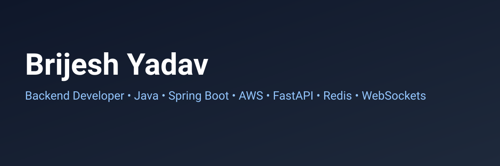

# Portfolio — Brijesh Yadav

[](https://recscse.github.io/portfolio/index.html)
[](https://www.linkedin.com/in/brijesh-yadav-)


<p align="center">
  
</p>

## 🚀 About Me

Hi, I’m **Brijesh Yadav**. I'm a **Backend Software Engineer** with **5+ years of experience** building scalable microservices, distributed systems, and real-time applications. I specialize in turning complex enterprise requirements into robust APIs, event-driven pipelines, and cloud-native backend systems using **Java, Spring Boot, Python, FastAPI, PostgreSQL, Redis, and WebSockets**.

- **💼 Current Role:** Software Engineer @ ArisGlobal (Oct 2021 – Present)
- **📍 Location:** Mysore, India
- **📧 Email:** brijeshyadav30599@gmail.com
- **🔭 Technical Focus:** Distributed Systems, Microservices, Event-Driven Architecture, Real-Time Data Pipelines

---

## 🛠️ Technical Stack

**Backend & Core Systems**


**Databases & Storage**


**Cloud & DevOps**


**Frontend (Secondary)**


---

## 🎨 Portfolio Architecture

* **✨ Glassmorphism Interface:** Modern dark/light UI with CSS variables and responsive glassmorphism aesthetic.
* **🌗 System Theme Persistence:** System-aware theme switcher stored in `localStorage`.
* **📱 Mobile-First Layout:** Responsive across mobile, tablet, and desktop breakpoints.
* **📝 Deep-Dive Engineering Case Studies:** Technical blog section featuring architecture diagrams, system design breakdowns, and code snippets.
* **📂 Filterable Project Showcase:** Categorized project gallery highlighting core technical accomplishments, status badges, PyPI metadata, and verified links.

---

## 📂 Project Structure

```bash
portfolio/
├── index.html          # Main Landing Page
├── projects.html       # Filterable Project Showcase
├── skills.html         # Full Technical Stack & Capabilities
├── mystyle.css         # Main Global Styles (Variables, Glassmorphism)
├── assets/             # Resume PDF & SVGs
└── blog/               # Engineering Case Studies & Notes
    ├── index.html      # Blog Index Page
    ├── blog.css        # Blog Typography & Terminal Box Styles
    └── ...             # Individual Case Study HTML Pages
```

---

## 🧪 Featured Systems & Open-Source Projects

### 1. [Upstox Auth Pro (Python SDK)](https://github.com/growthquantix/upstox-auth-pro)
**Stack:** Python, Playwright, pyotp, OAuth2, PyPI, GitHub Actions
* Published open-source Python SDK automating Upstox OAuth2 login, Playwright 2FA automation, and TOTP key calculation.
* Available on PyPI: `pip install upstox-auth-pro`.
* Features pluggable token storage, IST-aware expiration checks, and diagnostic screenshot capturing.
* [PyPI Package](https://pypi.org/project/upstox-auth-pro/) · [GitHub Repo](https://github.com/growthquantix/upstox-auth-pro) · [Documentation](https://growthquantix.github.io/upstox-auth-pro/)

### 2. [Growth Quantix](blog/designing-real-time-market-data-pipeline-algorithmic-trading.html)
**Stack:** Python, FastAPI, PostgreSQL, Redis Pub/Sub, WebSockets, React
* Algorithmic trading and real-time market data infrastructure supporting multi-broker integrations (Upstox V3 APIs, Dhan, Fyers).
* Engineered a decoupled Redis Pub/Sub data bus for tick distribution, risk isolation barriers, and paper-trading parity.
* [Read System Architecture Case Study](blog/designing-real-time-market-data-pipeline-algorithmic-trading.html)

### 3. [Upstox Auth Pro Java](https://github.com/growthquantix/upstox-auth-pro-java)
**Stack:** Java, Maven, OAuth2, REST APIs
* Open-source Java SDK automating Upstox OAuth2 authentication and token management for trading applications.
* Features strongly-typed OAuth2 models and Spring Boot integration interfaces.
* [GitHub Repository](https://github.com/growthquantix/upstox-auth-pro-java)

### 4. [Prindox](https://prindox.com)
**Stack:** Python, FastAPI, PostgreSQL, REST APIs
* Online document processing platform supporting document uploads, print-order workflows, and async background validation.
* [Live site](https://prindox.com) (source code is private)

---

## ✍️ Featured Engineering Case Studies

I write in-depth case studies about backend software engineering, real-time data pipelines, and system security.

* **[Building a Production-Ready OAuth2 Automation SDK for Upstox](blog/building-production-ready-oauth2-automation-sdk-upstox.html)** — *Feb 15, 2026*
* **[Designing a Real-Time Market Data Pipeline for an Algorithmic Trading Platform](blog/designing-real-time-market-data-pipeline-algorithmic-trading.html)** — *Feb 18, 2026*
* **[Designing a Safe AI-Assisted Trading System: From Stock Selection to Execution](blog/designing-safe-ai-assisted-trading-system.html)** — *Feb 20, 2026*

[Read all engineering notes →](blog/index.html)

---

## 📊 GitHub Dashboard

<p align="center">
  
  
</p>

---

## Development

The site is plain HTML styled with [Tailwind CSS](https://tailwindcss.com), compiled to `assets/site.css` and served by GitHub Pages. There is no runtime framework.

```bash
npm install                    # once: Tailwind v4 + typography plugin
python scripts/generate.py     # regenerate pages from scripts/site_data.py and content/blog/
npm run build                  # compile Tailwind to assets/site.css
python scripts/validate.py --online   # links, anchors, images, canonical URLs, banned/unsupported claims
```

- Facts live in one place: `scripts/site_data.py`. If a claim is not evidenced there, it is not on the site.
- Blog article bodies are in `content/blog/`; the generator wraps them in the shared layout.
- Skill icons are bundled locally in `assets/icons/` (Devicon, MIT), so there are no third-party icon requests.
- Older self-audit reports are kept in `docs/archive/` for reference only; see `docs/AUDIT_2026-11.md` for the current audit.
